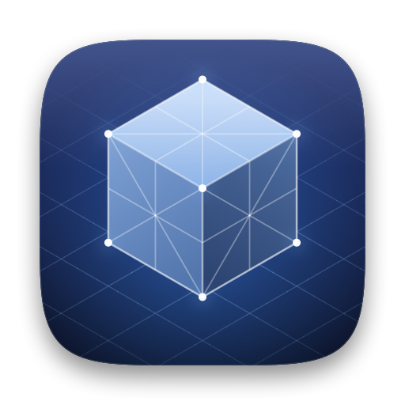
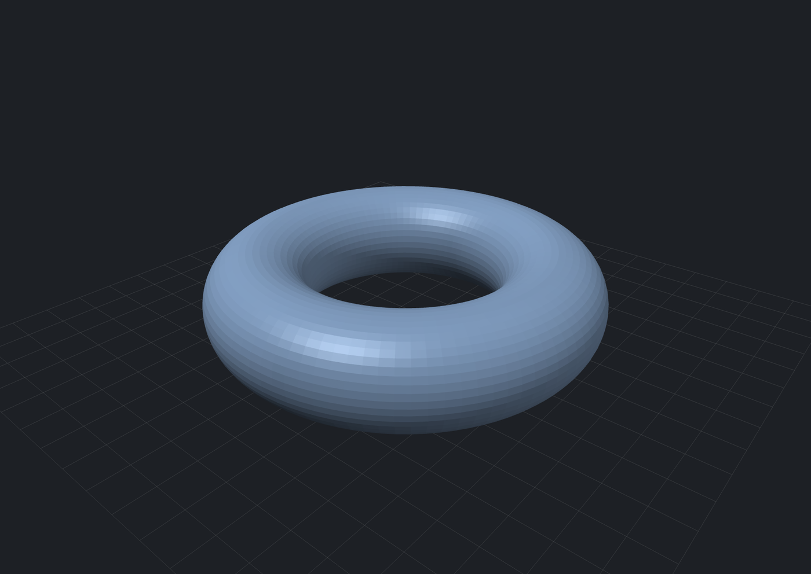

<p align="center"></p>

# STL Viewer

A small, fast, native macOS viewer for STL files. Double-click an `.stl` in Finder and it opens straight into a window you can orbit, pan and zoom. No dependencies: about a thousand lines of Swift, rendered with Metal.

<p align="center"></p>

## Features

- Opens **binary and ASCII** STL files, including binary files with a `solid` header and files containing bad (NaN) triangles
- Fast: a 108 MB, 2.16M-triangle file loads in about 50 ms on Apple silicon
- Orbit / pan / zoom with mouse or trackpad, standard views, zoom to fit, perspective or orthographic
- Wireframe overlay and a ground grid aligned to nice round numbers in the file's own units
- Shading is computed from the geometry, so missing or flipped normals in a file don't break the lighting
- One window per file; select several in Finder to open them all; drag files onto a window or the Dock icon
- Follows light and dark mode

## Install

Built to target macOS 13 or later (tested on macOS 27) and needs the Xcode command line tools (`xcode-select --install`).

```bash
git clone https://github.com/hamzaahmadk/stl-viewer.git
cd stl-viewer
./build.sh --install    # builds and copies "STL Viewer.app" into /Applications
```

`./build.sh` without `--install` leaves the app next to the script instead. It builds for the Mac you run it on.

To make Finder open STL files with it, launch it once and choose **STL Viewer → Set as Default for STL Files…**. You can also use Finder's Get Info → Open with → Change All.

## Controls

| Action | How |
|---|---|
| Orbit | Drag |
| Pan | Two-finger scroll, ⌥/⇧-drag, or right-drag |
| Zoom | Pinch, mouse wheel, ⌘-scroll, or ⌘+ / ⌘− |
| Fit to window | `F` or double-click |
| Reset view | `0` |
| Standard views | `1`–`6`: front, back, left, right, top, bottom |
| Wireframe / grid / orthographic | `W` / `G` / `P` |
| Nudge rotation | Arrow keys |

The bar at the bottom of each window shows the triangle count, the model's dimensions and the grid spacing. STL files carry no units, so these are raw numbers (usually millimetres).

## Notes and limitations

- Z is up, as in most CAD and slicer software.
- Faces are flat-shaded, the way slicers show STLs. There is no smooth shading.
- The app is ad-hoc signed. That is fine for a copy you build yourself; a copy downloaded from elsewhere would need right-click → Open the first time.
- Only tested on Apple silicon running macOS 27; other setups should work but haven't been tried.

## Project layout

| Path | What it is |
|---|---|
| `Sources/STLLoader.swift` | Binary and ASCII STL parser |
| `Sources/Camera.swift` | Orbit camera and matrix helpers |
| `Sources/ViewerView.swift` | Metal renderer, shaders, mouse / trackpad / keyboard input |
| `Sources/ViewerWindowController.swift` | One window per file, info bar, loading |
| `Sources/AppDelegate.swift` | Menus, opening files, default-app support |
| `tools/make_icon.swift` | Draws the app icon; `tools/make_icon.sh` packages `Resources/AppIcon.icns` |
| `build.sh` | Builds, signs and optionally installs the app |

The project folder can live in iCloud Drive, but `build.sh` builds in a temporary folder because iCloud keeps attaching Finder metadata to app bundles, which makes `codesign` fail.
